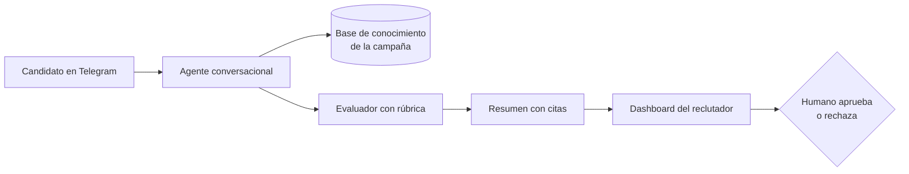

# Overview — Entrevistas agénticas para reclutamiento

> **Ejemplo trabajado.** Deep research de validación sobre el dominio de EntreVista AI. Las cifras son las de la investigación original del ejemplo; verifícalas en su fuente antes de citarlas en un producto real.

## 1. Qué es una entrevista agéntica

Un agente de IA conduce la primera entrevista de un proceso de selección: hace preguntas sobre competencias, **repregunta según lo que responde el candidato** y entrega al reclutador un resumen con evidencia. La diferencia con un chatbot de reclutamiento de primera generación:

| | Chatbot de reglas | Entrevista agéntica |
|---|---|---|
| Preguntas | Fijas, definidas de antemano | Adaptativas, con repreguntas |
| Respuestas del candidato | Opción múltiple o texto libre que no se analiza | Texto libre que el agente razona |
| Output | Filtro sí/no por requisitos | Puntaje por competencia con citas |
| Experiencia | Formulario disfrazado de conversación | Conversación |

## 2. Arquitectura típica

Piezas que se repiten en las plataformas estudiadas:
- **Motor conversacional** con estado de sesión (activa, pausada, abandonada, completada).
- **Rúbricas por rol**: competencias, pesos y criterios por nivel.
- **Evaluación con evidencia**: cada puntaje enlazado al fragmento de la conversación que lo justifica.
- **Guardrails**: el agente solo responde con información cargada por la empresa y escala lo que no sabe.
- **Cola de revisión humana**: la IA recomienda, el reclutador decide.

## 3. Impacto operativo reportado

- Candidatos que vivieron entrevistas agénticas bien diseñadas las describen como personalizadas: en el caso Bright Apply, el 93 % sintió que las preguntas y respuestas fueron personalizadas y relevantes.
- En el caso Mishcon de Reya, los candidatos destacaron que el formato conversacional les dio más oportunidades de compartir ideas.
- Con chatbots de reglas pasa lo contrario: en encuestas de clima laboral de 2025, el 47 % de candidatos dijo que hacían el proceso frío, transaccional e impersonal.
- La consistencia mejora cuando todas las entrevistas usan la misma rúbrica; con entrevistas humanas, cada reclutador pregunta y evalúa distinto.

## 4. Marco regulatorio

- **EU AI Act:** clasifica los sistemas de IA para reclutamiento como de **alto riesgo**, con plena aplicación desde agosto de 2026, y prohíbe el reconocimiento de emociones en el trabajo (art. 5). Aplica a empresas que operen en la UE, pero marca el estándar que siguen los clientes globales.
- **Colombia:** proyecto de ley de IA ética en trámite.
- **Transparencia:** el 79 % de los postulantes exige saber si una máquina está evaluando su futuro laboral.

Implicaciones de diseño: consentimiento explícito, decir siempre que es una IA, nada de biometría ni análisis emocional, decisiones finales humanas y trazabilidad de cada evaluación.

## 5. Señales del mercado

- En 2025 Workday adquirió Paradox: la capa conversacional ya es parte del software enterprise de adquisición de talento.
- Los referentes globales (Glider AI, HireVue) evalúan con video o tareas prácticas y tienen pricing enterprise.

## 6. Preguntas abiertas

- ¿Qué canal usan de verdad los candidatos de BPO en LATAM: Telegram, WhatsApp o web?
- ¿Cuánto mejora el time-to-hire en LATAM? Los datos publicados son de Estados Unidos y Europa.
