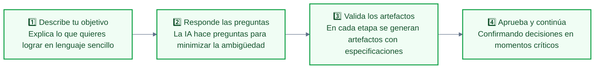
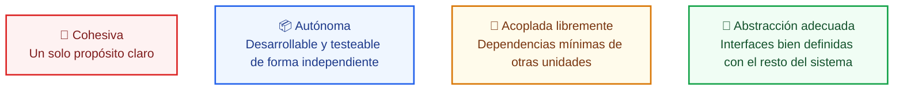
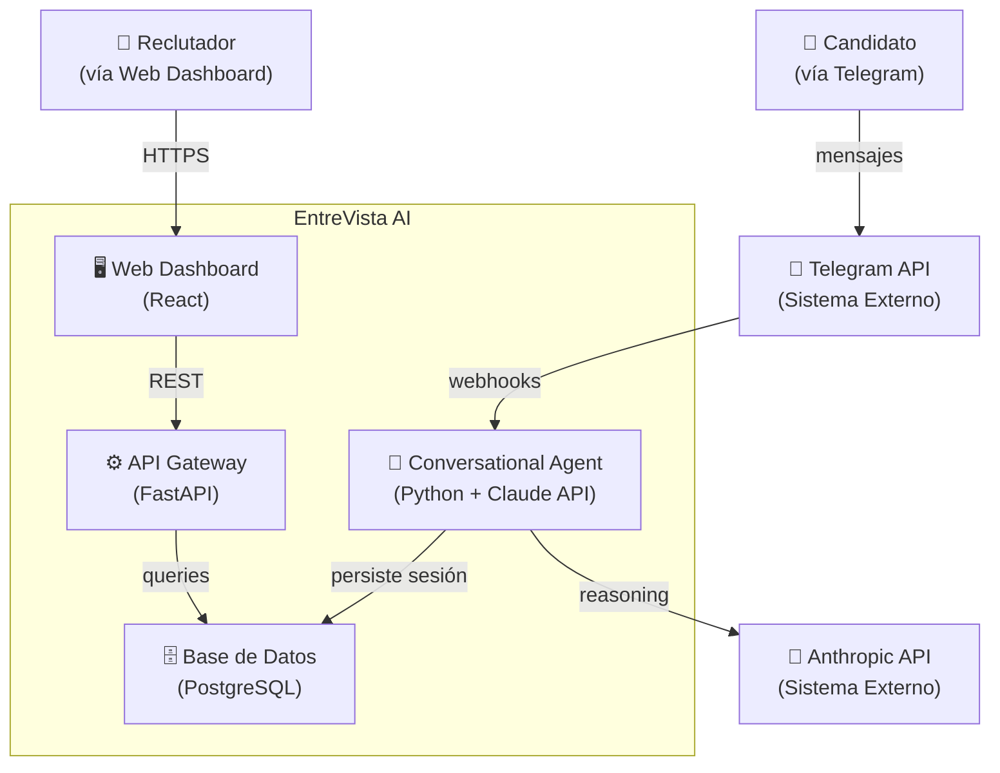

# Runbook · Estación 4: Diseñando el QUÉ
**Spec-Driven Development con AI-DLC 2 · Fase Inception**

**Producto guía:** *EntreVista AI*, plataforma de screenings conversacionales vía Telegram

---

## 📋 Índice

1. [¿Para qué sirve este runbook?](#para-qué-sirve-este-runbook)
2. [Fundamento conceptual](#fundamento-conceptual)
3. [Setup: AI-DLC en tu repo](#setup-ai-dlc-en-tu-repo)
4. [Inicio del flujo](#inicio-del-flujo)
5. [Las fases de AI-DLC](#las-fases-de-ai-dlc)
6. [Fase Inception, etapa por etapa](#fase-inception)
7. [Arquitectura Just-in-Time: C4, NFRs y ADR](#arquitectura-just-in-time)
8. [Checklist de entrega](#checklist-de-entrega)
9. [Recursos](#recursos)

---

## ¿Para qué sirve este runbook?

Este documento es tu guía de trabajo activo durante y después de la sesión. No es una transcripción de clase: es el material que usas con las manos en el teclado. Los comandos y la tarea están resumidos en el [README](README.md); aquí está el porqué de cada etapa y cómo validar lo que genera el agente.

Al terminar tendrás, en tu repo personal, la fase Inception de tu producto:

| Etapa de AI-DLC | Artefactos | Qué responde |
| :--- | :--- | :--- |
| 2.1 Reverse Engineering | 9 documentos del código existente (en `aidlc/spaces/default/codekb/`) | ¿Desde qué código arranco? |
| 2.2 Practices Discovery | `team-practices.md`, `discovered-rules.md` | ¿Qué convenciones ya sigue mi repo? |
| 2.3 Requirements Analysis | `requirements.md` | ¿Qué hace mi sistema y cómo se comporta? |
| 2.4 User Stories | `personas.md`, `stories.md` | ¿Qué necesitan mis usuarios y cómo lo verifico? |
| 2.6 Domain Design | `components.md`, `decisions.md` | ¿Qué piezas tiene mi sistema y qué decidí? |
| 2.7 Units Generation | `unit-of-work.md`, `unit-of-work-dependency.md`, `unit-of-work-story-map.md` | ¿Cuáles son las unidades mínimas de trabajo? |
| 2.8 Contract Design | `contract-summary.md` | ¿Cómo se hablan las unidades entre sí? |
| 2.9 Delivery Planning | `bolt-plan.md` y otros | ¿En qué orden construyo? |

Más tu arquitectura Just-in-Time en `specs/arquitectura.md`. Todo esto es la **entrada obligatoria de la Estación 5 (Construction)**. Sin ella el agente construye código sin contrato, y sin contrato no hay forma de saber si lo que generó es correcto.

> Las etapas 2.5 (Refined Mockups) y 2.8 (Contract Design) son condicionales: AI-DLC las salta si tu producto no tiene interfaz o si las unidades no necesitan contratos.

---

## Fundamento conceptual

### El problema que resuelve SDD

La IA genera volumen. Sin estructura, ese volumen es deuda técnica acelerada. El 45% del código generado por IA tiene vulnerabilidades de seguridad (Veracode, 2025) — no porque los modelos sean malos, sino porque reciben instrucciones ambiguas.

**Vibe coding vs Spec coding:**

| | Vibe | Spec |
| :--- | :--- | :--- |
| **Flujo** | Prompt → código → rezo | Especificación → código verificable |
| **Cuándo usarlo** | Prototipos de un día, exploración | Cualquier producto que deba sobrevivir más de una semana |
| **El riesgo** | Código que nadie entiende en dos semanas | Tiempo invertido en especificación (que se recupera en Construction) |

> **Principio central:** corregir en la especificación es 10x más barato que en código y 100x más barato que en producción. La IA no reemplaza el pensamiento de producto — lo amplifica cuando tiene un contrato preciso.

### Los tres frameworks de especificación

Antes de aplicar AI-DLC, entender por qué se elige sobre las alternativas:

| Framework | Filosofía | Cuándo usarlo |
| :--- | :--- | :--- |
| **Open Spec** | "Fluido no rígido, iterativo no cascada." Brownfield-first. | Equipos senior · Proyectos pequeños/ágiles · Velocidad sobre estructura |
| **Spec Kit** | Las especificaciones sirven al código; el código sirve a las especificaciones. | Separación clara de roles · Equipos con perfiles junior · Necesitan verificación formal |
| **AI-DLC** | Nativo para co-crear con IA. Trazabilidad integral + DDD integrado. | Trazabilidad completa · Lógica de dominio compleja · Entornos que deben escalar |

Para productos con lógica de negocio no trivial y equipos que van a iterar en el tiempo, **AI-DLC es la opción correcta**.

### XDD: DDD + BDD + TDD — la base de cualquier especificación seria

Estos tres no son buzzwords. Son el fundamento que hace que los artefactos de Inception sean ejecutables en Construction:

- **DDD (Domain-Driven Design):** Define los límites del dominio y el lenguaje de negocio compartido. Responde: ¿qué entidades y conceptos gobiernan este sistema?
- **BDD (Behavior-Driven Development):** Define el comportamiento esperado del sistema desde la perspectiva del usuario. Los escenarios Gherkin son sus artefactos.
- **TDD (Test-Driven Development):** Ciclo Red → Green → Refactor. Los escenarios BDD se convierten en tests antes que en código.

```
DDD define el QUÉ existe  →  BDD define CÓMO se comporta  →  TDD garantiza que funciona
```

---

## Setup: AI-DLC en tu repo

> 🔗 **Repositorio oficial:** [awslabs/aidlc-workflows](https://github.com/awslabs/aidlc-workflows) · **Versión del programa:** la de [`versions.md`](../versions.md)

AI-DLC 2 es un CLI (`aidlc`) que instala el flujo dentro de tu coding agent. Trabajas en **tu repo personal**, el mismo donde está tu walking skeleton de la Estación 3 y tu PRD en `specs/prd.md`.

### 1. Instala el CLI (una vez por computadora)

```sh
# macOS, Linux o WSL
curl -fsSL https://github.com/awslabs/aidlc-workflows/releases/latest/download/install.sh | sh

# Windows (PowerShell normal, no como administrador)
irm https://github.com/awslabs/aidlc-workflows/releases/latest/download/install.ps1 | iex
```

Abre una terminal nueva y verifica con `aidlc --version`.

### 2. Configúralo en tu repo, para tu herramienta

```sh
cd tu-repo
git switch -c estacion-4
aidlc config --harness claude     # o codex, cursor, copilot
aidlc doctor
```

`aidlc config` agrega los archivos del flujo para tu herramienta (por ejemplo, `.claude/` en Claude Code) y una carpeta `aidlc/` donde quedarán todos los artefactos. No toca tu `AGENTS.md` salvo para agregar un bloque marcado, y respeta tus skills.

> ⚠️ **Antigravity:** AI-DLC 2 no tiene integración con Antigravity. Para las Estaciones 4 a 7 usa Claude Code u otra de las herramientas soportadas.

### 3. Describe tu stack para que el agente no lo invente

Crea `aidlc/spaces/default/knowledge/aidlc-shared/technical-environment.md` con el stack de tu walking skeleton. Todas las etapas lo leen. Mínimo:

```markdown
# Entorno técnico

- Lenguaje y framework: TypeScript, Next.js (App Router), Node 22
- Tests: Vitest; `npm run verify` corre lint, tipos y tests
- LLM: Claude con @anthropic-ai/sdk; el modelo sale de ANTHROPIC_MODEL
- Despliegue: Vercel desde main; la infraestructura en AWS llega en la Estación 9
- No usar: otro lenguaje de backend ni otro proveedor de despliegue sin un ADR
```

### Estructura resultante

```
tu-repo/
├── AGENTS.md, CLAUDE.md          ← tus instrucciones (E3), con el bloque de AI-DLC
├── .claude/ (o .codex/, .cursor/, .github/)  ← el flujo AI-DLC para tu herramienta
├── specs/prd.md                  ← tu PRD de la Estación 2
├── aidlc/spaces/default/
│   ├── knowledge/aidlc-shared/technical-environment.md
│   ├── codekb/<tu-repo>/         ← lo que encontró Reverse Engineering
│   └── intents/<fecha>-<nombre>/ ← estado, auditoría y artefactos de cada fase
└── app/, lib/, tests/            ← el código, que sigue en su lugar
```

> ⚠️ **Regla crítica:** el código va donde siempre. AI-DLC guarda especificaciones, estado y auditoría en `aidlc/` y nunca código de la aplicación.

---

## Inicio del flujo

Abre tu herramienta en la raíz del repo (si ya estaba abierta, ciérrala y ábrela de nuevo) e inicia el flujo con el perfil `classic`, que hace Inception y Construction con una aprobación humana por etapa:

```
/aidlc classic Lee specs/prd.md y diseña el producto que describe, sobre el walking skeleton que ya está en este repo.
```

En Codex el comando es `$aidlc`. AI-DLC lee el PRD, propone el plan (las etapas que va a correr) y espera tu confirmación.

### Ejemplo con EntreVista AI

> **🚀 PROMPT:**
>
> *"/aidlc classic Lee specs/prd.md y diseña el producto que describe: una plataforma de entrevistas agénticas que conduce screenings conversacionales vía Telegram para empresas de alto volumen en América Latina, sobre el walking skeleton que ya está en este repo."*

**Qué esperar como respuesta:** el plan con sus etapas y puertas de aprobación. Confírmalo. A partir de ahí el flujo lleva el ritmo: te pregunta, genera el artefacto de cada etapa y se detiene a pedir tu aprobación.

**Para retomar otro día:** abre tu herramienta y escribe `/aidlc`. Retoma donde quedó, con la pregunta pendiente si había una. `/aidlc --status` te dice en qué etapa vas.

---

## Las fases de AI-DLC

| Fase | Qué hace | En el programa |
| :--- | :--- | :--- |
| 0. Initialization | Detecta el proyecto (nuevo o existente) y prepara el estado | E4, automática |
| 1. Ideation | Captura la intención, investiga mercado y factibilidad | Ya lo hiciste en E1 y E2; el perfil `classic` la salta |
| 2. Inception | El QUÉ: requerimientos, historias, diseño de dominio, unidades y plan | **E4** |
| 3. Construction | El CÓMO: diseño funcional, NFRs, infraestructura, código y tests por unidad | E5 |
| 4. Operation | Despliegue, observabilidad e incidentes | E9 a E11 lo trabajan con sus propias herramientas |

**Esta estación cubre la fase Inception.** No avances a Construction sin aprobar Inception completa: técnicamente se puede, pero los artefactos de Construction dependen de los de Inception para ser precisos.


### El loop de intenciones — cómo trabajas con el agente en cada etapa



**El paso más importante es el 4.** El flujo te pide aprobación antes de continuar a la siguiente etapa. No lo omitas con un "sí, continúa todo" automático — ese es el momento donde el humano mantiene el control. Lee el artefacto generado antes de aprobar.

---

## Fase Inception

> 🎯 **Objetivo:** Definir la "Única Fuente de Verdad" antes de escribir una línea de código.
> Captura intenciones → elabora requisitos → desglosa el trabajo en unidades manejables.

### Mapa de etapas (perfil `classic`)

| # | Etapa | Artefacto principal | Alimenta a |
| :--- | :--- | :--- | :--- |
| 0.1–0.3 | Initialization | `aidlc-state.md` | Todas las etapas |
| 2.1 | Reverse Engineering | 9 documentos del código existente | Todas las etapas |
| 2.2 | Practices Discovery | `team-practices.md` | Construction |
| 2.3 | Requirements Analysis | `requirements.md` | User Stories, Domain Design |
| 2.4 | User Stories | `personas.md`, `stories.md` | Units Generation, tests de E5 |
| 2.5 | Refined Mockups | Mockups e interacción | Construction (si hay UI) |
| 2.6 | Domain Design | `components.md`, `decisions.md` | Units Generation |
| 2.7 | Units Generation | `unit-of-work.md` y dependencias | Contract Design, Estación 5 |
| 2.8 | Contract Design | `contract-summary.md` | Estación 5 |
| 2.9 | Delivery Planning | `bolt-plan.md` | Estación 5 |

---

### 0.1–0.3 Initialization y 2.1 Reverse Engineering

**¿Qué hacen?** Initialization detecta si el proyecto es nuevo (greenfield) o tiene código (brownfield) y crea el estado del flujo. Tu repo ya tiene el walking skeleton, así que es **brownfield**: corre Reverse Engineering, que escanea el código y escribe nueve documentos (arquitectura, estructura, stack, etc.) en `aidlc/spaces/default/codekb/<tu-repo>/`.

**Qué validar:**
- [ ] El stack detectado coincide con tu `technical-environment.md` (Next.js, TypeScript, Vitest, Vercel).
- [ ] Encontró tu endpoint del agente, tus tests y tu CI de la Estación 3.
- [ ] No inventó piezas que no existen.

Sin este análisis, el agente asume, y los supuestos incorrectos generan artefactos que no corresponden a tu realidad. Construir sobre un mapa incorrecto multiplica la deuda técnica.

### 2.2 Practices Discovery

**¿Qué hace?** Detecta las prácticas de tu repo (comandos, convenciones, CI, controles de seguridad) y te pregunta por las que no puede inferir. Lo que confirmes queda en la memoria del proyecto y lo respetan todas las etapas siguientes.

**Cómo trabajarla:** confirma lo que ya está en tu `AGENTS.md` y tu CI: `npm run verify` antes de cada commit, tests sin llamar a la API real, secretos solo en variables de entorno.

---

### 2.3 Requirements Analysis

**¿Qué hace?** Refina las necesidades del PRD mediante preguntas de clarificación, eliminando ambigüedades técnicas antes de que se conviertan en código incorrecto. El agente te hará preguntas — respóndelas con precisión.

**Artefacto generado:** `requirements.md` (en `inception/requirements-analysis/`)

#### Las tres dimensiones del análisis

**1. Functional Requirements — ¿Qué hace el sistema?**

Lista las capacidades del sistema que producen valor directo al usuario. Son los "verbos" del producto.

*Ejemplo (EntreVista AI):*
- [x] Core Agental Reasoning — el agente razona, repregunta y adapta el screening en tiempo real.
- [x] Telegram API Integration — la interfaz conversacional es Telegram, sin app adicional para el candidato.

**Cómo construir los tuyos:** Por cada épica de tu PRD, pregúntate: ¿qué acción concreta realiza el sistema? Si la respuesta es vaga ("gestionar usuarios"), descompone hasta que sea específica ("crear cuenta de reclutador con email + contraseña", "autenticar reclutador con JWT").

**2. Non-Functional Requirements — ¿Cómo se comporta el sistema?**

Definen la calidad del comportamiento, no el comportamiento en sí. Son los "adverbios" del producto. Sin ellos, el agente optimiza solo para que funcione, no para que escale o sobreviva.

*Ejemplo (EntreVista AI):*
- [x] Response Latency < 2s — el candidato no puede esperar más de 2 segundos entre su respuesta y la del agente.
- [ ] 99.5% Availability — ~3.6h de downtime mensual aceptable. Balance óptimo costo/estabilidad para MVP.

**Cómo construir los tuyos:** Para cada NFR define un valor numérico concreto, no un adjetivo. "Rápido" no es un NFR. "P95 de latencia < 500ms" sí lo es. Si no puedes medirlo, no puedes verificarlo.

**3. Success Criteria (MVP) — ¿Cómo sabemos que funciona?**

Los criterios de éxito del MVP son el filtro de scope. Todo lo que no cabe aquí es post-MVP. Son binarios: o se cumple o no se cumple.

*Ejemplo (EntreVista AI):*
- [x] Conversación fluida completada de inicio a fin por el candidato.
- [x] Notificación al reclutador al finalizar el screening con resultado estructurado.

> ⚠️ **Actores Out of Scope (MVP):** Administrador y Hiring Manager. Esta decisión explícita evita que el agente genere funcionalidades que no son del MVP.

#### Usuarios del Sistema

Documenta quién interactúa con el sistema y cómo accede:

| Actor | Descripción | Acceso |
| :--- | :--- | :--- |
| **Candidato** | Persona entrevistada. Sin cuenta requerida. | Link único por entrevista |
| **Reclutador** | Configura entrevistas, envía links, revisa resultados. | Cuenta con credenciales en plataforma |

**Regla de oro:** si un actor no aparece en los criterios de éxito del MVP, está Out of Scope. Ponlo explícitamente en el artefacto para que el agente no lo infiera.

---

### 2.4 User Stories

**¿Qué hace?** Traduce los requerimientos en comportamientos verificables desde la perspectiva del usuario. Los escenarios Gherkin generados aquí se convertirán directamente en tests de aceptación en la Estación 5.

**Artefactos generados:** `personas.md` y `stories.md` (en `inception/user-stories/`)

#### Parte 1 — Personas

Una Persona es una representación semi-ficticia del usuario real, enfocada en necesidades psicológicas y laborales. No es un perfil demográfico — es un modelo de motivaciones y frustraciones.

*Ejemplo (EntreVista AI):*

**Valentina** — Reclutadora Tech Startup
- **Necesidades:** Evaluar candidatos de forma consistente, reducir tiempo por screening, tener evidencia documentada de cada evaluación.
- **Pain Points:** Los screenings manuales toman 45 min por candidato · Los chatbots actuales no adaptan preguntas · No hay registro estructurado del comportamiento del candidato.
- **Goals:** Hacer 3x más screenings por semana · Reducir bias en la selección inicial · Tener un sistema que escale sin contratar más reclutadores.

**Cómo construir la tuya:** Basa la persona en entrevistas reales o en tu conocimiento del usuario. El agente te hará preguntas de clarificación — responde con datos reales, no con suposiciones optimistas.

#### Parte 2 — Backlog de historias

Las historias se organizan por **Epics** (capacidades del agente o del sistema), no por pantallas ni por tareas técnicas.

**Formato de historia:**

```
Como [tipo de usuario]
quiero [acción/capacidad]
para [beneficio/objetivo]
```

*Ejemplo:*
```
Como Reclutadora
quiero que el agente evalúe automáticamente si un candidato cumple los criterios del rol
para reducir el tiempo de revisión manual de screenings
```

#### Parte 3 — Escenarios Gherkin

Cada historia tiene uno o más escenarios con criterios de aceptación en lenguaje Gherkin. Este formato no es opcional — es lo que transforma una historia en un test ejecutable.

**Estructura:**

```gherkin
Escenario: [Nombre descriptivo del caso]
  DADO QUE [precondición del sistema o del usuario]
  Y [condición adicional si aplica]
  CUANDO [acción del usuario o del sistema]
  ENTONCES [resultado observable y verificable]
  Y [resultado adicional si aplica]
```

*Ejemplo (EntreVista AI):*

```gherkin
Escenario: Candidato completa screening exitosamente
  DADO QUE el candidato tiene una conversación activa en Telegram
  Y cumple con los requisitos mínimos del rol definidos en la campaña
  CUANDO confirma el final de la conversación con el agente
  ENTONCES el sistema registra el resultado como 'APTO'
  Y envía una notificación al reclutador con el resumen estructurado del screening
```

```gherkin
Escenario: Agente repregunta ante respuesta ambigua
  DADO QUE el candidato ha respondido una pregunta de forma vaga o incompleta
  CUANDO el agente evalúa la respuesta contra los criterios del rol
  ENTONCES el agente formula una pregunta de seguimiento específica
  Y no avanza a la siguiente pregunta del screening hasta obtener una respuesta evaluable
```

**Cómo construir los tuyos:** Escribe al menos 2 escenarios por historia: el camino feliz (happy path) y al menos un caso alternativo (error, edge case, o comportamiento inesperado del usuario). Los tests que más valor aportan suelen estar en los casos alternativos.

> 💡 **Tip:** Si no puedes escribir el `ENTONCES` de forma que sea verificable automáticamente, el requerimiento es ambiguo. Vuelve a Requirements Analysis y clarifica antes de continuar.

---

### 2.5 Refined Mockups

**¿Qué hace?** Si tu producto tiene interfaz, genera mockups y la especificación de interacción de las pantallas de tus historias. Si no tiene interfaz, AI-DLC la salta.

**Cómo trabajarla:** valida que cada pantalla corresponda a una historia y que los estados de error de tus escenarios Gherkin aparezcan en la interfaz.

---

### 2.6 Domain Design

**¿Qué hace?** Genera el blueprint del sistema: los componentes, cómo se conectan y las decisiones de arquitectura que tomaste en el camino. Es el artefacto que más alimenta la fase Construction.

**Artefactos generados:** `components.md` y `decisions.md` (en `inception/domain-design/`)

#### Las dos capas del diseño

| Capa | Archivo | Qué define |
| :--- | :--- | :--- |
| **Componentes** | `components.md` | Estilo arquitectónico, capas, componentes con su responsabilidad y sus dependencias. |
| **Decisiones** | `decisions.md` | Los ADRs de las decisiones que tomaste en esta etapa: contexto, alternativas y consecuencias. |

#### Cómo leer y validar este artefacto

Cuando el agente genere el diseño, verifica:

- [ ] ¿Cada componente tiene una responsabilidad única y clara? (Single Responsibility)
- [ ] ¿Las dependencias fluyen en una sola dirección? (no hay ciclos)
- [ ] ¿Los componentes corresponden a dominios de negocio, no a operaciones técnicas?
- [ ] ¿Respeta tu `technical-environment.md`? Si propone otro lenguaje o desplegar fuera de Vercel, pregunta por qué antes de aprobar.

> 💡 **Señal de alerta:** Si un componente tiene más de 3–4 responsabilidades descritas, está haciendo demasiado. Pídele al agente que lo descomponga antes de aprobar.

---

### 2.7 Units Generation

**¿Qué hace?** Descompone el trabajo en unidades autónomas y cohesivas. Cada unidad es una pieza de Lego que, al unirse con las demás, construye el sistema completo. Son el input directo de la Estación 5.

**Artefactos generados:** `unit-of-work.md`, `unit-of-work-dependency.md` (el grafo de dependencias) y `unit-of-work-story-map.md` (en `inception/units-generation/`)

#### ¿Qué es una Unidad?



#### Principio de generación: por dominio de negocio, no por capa técnica

❌ **No hagas esto** (organización por capa técnica):
- Unidad 1: Base de datos
- Unidad 2: API REST
- Unidad 3: Frontend

✅ **Haz esto** (organización por dominio de negocio):
- Unidad 1: Auth & Session Management
- Unidad 2: Interview Campaign Management
- Unidad 3: Conversational Agent (Core Domain)
- Unidad 4: Evaluation & Results

La diferencia es que las unidades por dominio pueden construirse y testearse de forma completamente independiente. Las unidades por capa siempre tienen acoplamiento vertical.

#### Estructura de cada unidad en el artefacto

Por cada unidad, el artefacto documenta:

- **ID:** `U1`, `U2`, `U3`...
- **Nombre:** nombre del dominio de negocio que gestiona.
- **Responsabilidad:** qué hace esta unidad y solo esta unidad.
- **Historias de usuario asociadas:** qué historias de `stories.md` cubre.
- **Dependencias:** qué otras unidades necesita para funcionar (mínimas).
- **Interfaces expuestas:** qué ofrece al resto del sistema.

*Ejemplo (EntreVista AI):*

```
U1 — Auth & Session Management
Responsabilidad: Gestión de identidad del Reclutador y estado de sesión del Candidato.
HUs asociadas: HU-01, HU-02
Dependencias: ninguna (es la unidad base)
Interfaces: /auth/login, /auth/refresh, /auth/logout, SessionStore
```

#### Criterio de validación de una Unidad

Hazte estas preguntas antes de aprobar:
- [ ] ¿Puedo describir qué hace esta unidad en una sola oración sin usar "y"?
- [ ] ¿Podría un desarrollador diferente construirla en paralelo sin coordinación constante con los demás?
- [ ] ¿Tiene un contrato claro (interfaces) con el resto del sistema?

Si la respuesta a cualquiera es no, la unidad necesita ser redefinida o dividida.

---

### 2.8 Contract Design

**¿Qué hace?** Si tus unidades se comunican entre sí, define los contratos: endpoints, eventos o interfaces, con sus entradas, salidas y errores. Si no hacen falta, AI-DLC la salta.

**Cómo validarla:** cada dependencia de `unit-of-work-dependency.md` tiene su contrato, y cada contrato dice qué pasa cuando la otra unidad falla.

---


### 2.9 Delivery Planning

**¿Qué hace?** Cierra Inception con el plan de entrega: en qué orden se construyen las unidades, qué riesgos tiene cada orden y de qué dependencias externas depende. Después de esta etapa viene la puerta de verificación entre Inception y Construction.

**Artefactos generados:** `bolt-plan.md`, `risk-and-sequencing-rationale.md` y `external-dependency-map.md` (en `inception/delivery-planning/`)

#### Qué define el artefacto

1. **Orden de construcción:** qué se construye primero y por qué. Generalmente empieza por la unidad de autenticación/sesión porque es transversal a todo lo demás.
2. **Dependencias entre unidades:** qué unidad necesita estar terminada antes de que pueda empezar la siguiente.
3. **Riesgos de la secuencia:** qué pasa si una unidad se retrasa y cuál conviene construir primero para validar lo más incierto.
4. **Estrategia de construcción:** top-down (desde la API hacia abajo) o bottom-up (desde el dominio hacia arriba). AI-DLC recomienda bottom-up por DDD.

#### Cómo trabajar esta fase

El flujo te presentará preguntas estratégicas sobre el orden de construcción. Para responderlas, usa este criterio:

- **Primero:** lo que más unidades dependen de ello (generalmente auth/session).
- **Segundo:** el core del dominio de negocio (la funcionalidad que hace único a tu producto).
- **Último:** integraciones con servicios externos (APIs de terceros, notificaciones, etc.).

> 💡 **Para la Estación 5:** la primera unidad del plan es la que vas a construir completa. Elige una que pase por tu endpoint del agente: así tu walking skeleton crece en lugar de quedar al lado.

---


## Arquitectura Just-in-Time

> Esta sección complementa la fase Inception con tres decisiones arquitectónicas. Guárdalas en `specs/arquitectura.md` (C4 y NFRs) y agrega tus ADRs ahí o en `decisions.md`. Los prompts completos están en [`docs/prompts-ajit-arquitectura.md`](docs/prompts-ajit-arquitectura.md) y la plantilla de ADR en [`docs/adr-template.md`](docs/adr-template.md).
>
> Son tres decisiones arquitectónicas que la IA necesita entender antes de entrar a Construction. No son opcionales — son el puente entre especificar *qué* se construye y especificar *cómo* debe comportarse cuando escale.

La mayoría de los desarrolladores saltan directamente al código. En SDD, el primer paso es que la IA entienda **el dónde** está parada la solución. Sin este contexto, el agente construye piezas técnicamente correctas pero arquitectónicamente incoherentes.

### Bloque 1 — Visualización con C4 Model (Niveles 1 y 2)

**¿Qué es?** El C4 Model (Context and Container) es un sistema de diagramas en cuatro niveles de detalle. Para Inception solo necesitas los dos primeros.

- **Nivel 1 — Contexto del Sistema:** ¿Quién usa el sistema (actores) y con qué sistemas externos se conecta? Es el mapa de relaciones a 10,000 metros.
- **Nivel 2 — Contenedores:** ¿Qué piezas grandes componen el sistema? (Web App, API, Base de datos, Message Queue, etc.) y cómo se comunican entre sí.

**Por qué importa:** *"Si no puedes dibujar el sistema en 3 cajas, la IA va a construir 100 cajas sin sentido."* El C4 Nivel 1 y 2 es el contrato visual que evita que el agente invente arquitectura.

**Técnica IA — generar el diagrama en Mermaid.js:**

```
"Basándote en los artefactos de Inception generados, crea el diagrama C4 Nivel 1
(Contexto del Sistema) y Nivel 2 (Contenedores) en formato Mermaid.js.
Incluye todos los actores, sistemas externos y contenedores principales."
```

**Ejemplo de output esperado para EntreVista AI:**



**Validación del C4:** El diagrama está bien cuando cualquier persona del equipo puede responder en 30 segundos: ¿quién usa el sistema? ¿qué tecnologías principales tiene? ¿cómo fluyen los datos?

---

### Bloque 2 — Atributos de Calidad (NFRs aplicados arquitectónicamente)

**¿Qué es?** Los NFRs definidos en Requirements Analysis ahora se traducen en decisiones arquitectónicas concretas. Un desarrollador piensa en "que funcione"; un arquitecto piensa en "que no muera bajo carga, bajo ataque, y bajo mantenimiento sostenido".

Los cuatro atributos más relevantes para productos en etapa MVP:

| Atributo | Pregunta que responde | Táctica típica |
| :--- | :--- | :--- |
| **Disponibilidad** | ¿Qué pasa si el sistema cae? | Circuit breakers, health checks, degraded modes |
| **Escalabilidad** | ¿Qué pasa si 10x más usuarios entran mañana? | Caché, queues, stateless services |
| **Seguridad** | ¿Qué pasa si alguien intenta explotarlo? | JWT, rate limiting, input validation |
| **Mantenibilidad** | ¿Qué pasa cuando el equipo cambia? | Código limpio, tests, documentación automática |

**Técnica IA — el "Checklist de Supervivencia":**

```
"Analiza los artefactos de Inception de este proyecto e identifica los 3 atributos
de calidad más críticos para este MVP. Para cada uno:
1. Explica por qué es crítico para este producto específico.
2. Sugiere una táctica técnica concreta (con nombre de patrón o librería).
3. Indica cómo se verificaría que la táctica funciona."
```

*Ejemplo de output esperado para EntreVista AI:*

| NFR | Táctica | Verificación |
| :--- | :--- | :--- |
| Latencia < 2s | Caché de contexto de conversación en Redis · Respuestas en streaming de Claude API | Test de carga: P95 < 2s con 100 conversaciones simultáneas |
| Disponibilidad 99.5% | Degraded mode: si Redis falla, fallback a PostgreSQL para persistencia de sesión | Chaos test: matar Redis y verificar que las conversaciones activas no se interrumpen |
| Seguridad | JWT RS256 para autenticación del Reclutador · Rate limiting por IP en endpoints públicos | Pen test básico: intentar acceder a resultados sin token válido |

**Cómo usarlo:** No necesitas implementar todas las tácticas en el MVP. Lo que sí necesitas es *decidir* cuáles implementas y *documentar* cuáles dejas para después y por qué. Esa documentación va en el siguiente bloque.

---

### Bloque 3 — Architecture Decision Records (ADR)

**¿Qué es?** Un ADR es un documento corto que captura una decisión arquitectónica significativa, el contexto que la motivó y las consecuencias de tomarla. En AI-DLC, las decisiones se pierden en el chat si no se registran — el ADR es el rastro de migas de pan.

**Cuándo crear un ADR:** cada vez que tomes una decisión que sea difícil o costosa de revertir. Ejemplos: elección de base de datos, patrón de autenticación, arquitectura del agente, framework de backend.

**Estructura de un ADR:**

```markdown
# ADR-[número]: [Título descriptivo de la decisión]

## Contexto
[Por qué surgió esta decisión. Qué fuerzas estaban en juego.]

## Decisión
[Qué se decidió, de forma clara y sin ambigüedades.]

## Alternativas consideradas
- [Alternativa A] — descartada porque [razón]
- [Alternativa B] — descartada porque [razón]

## Consecuencias
- ✅ [Ventaja o resultado positivo de la decisión]
- ⚠️ [Trade-off o riesgo que se acepta con esta decisión]

## Estado
[Propuesto | Aceptado | Deprecado | Reemplazado por ADR-X]
```

**Técnica IA — "Destilar Decisiones":**

```
"Basado en nuestra discusión sobre [decisión], genera un ADR que documente:
- el contexto que nos llevó a esta decisión
- la decisión tomada
- las alternativas que consideramos y por qué las descartamos
- las consecuencias y trade-offs que aceptamos"
```

*Ejemplo (EntreVista AI) — ADR-001: Elección de canal conversacional:*

```markdown
# ADR-001: Uso de Telegram como canal conversacional del MVP

## Contexto
El producto requiere un canal conversacional accesible sin que el candidato instale
una app adicional. Se evaluaron WhatsApp Business API, Telegram Bot API y SMS.

## Decisión
Usar Telegram Bot API como canal conversacional para el MVP.

## Alternativas consideradas
- **WhatsApp Business API** — descartada por costo (aprobación + per-message fee)
  y restricciones de plantillas en conversaciones iniciadas por el sistema.
- **SMS** — descartada por limitaciones de longitud de mensaje y sin soporte nativo
  para conversaciones multi-turno estructuradas.

## Consecuencias
- ✅ API gratuita, bien documentada, con soporte nativo para bots conversacionales.
- ✅ Alta penetración en LATAM entre población trabajadora objetivo.
- ⚠️ Requiere que el candidato tenga cuenta de Telegram (fricción de onboarding).
- ⚠️ Dependencia de un tercero para el canal de comunicación principal.

## Estado
Aceptado
```

**Cuántos ADRs necesitas para Inception:** mínimo uno por cada decisión significativa tomada durante las etapas 2.3 a 2.9. Para un MVP típico, entre 3 y 6 ADRs es un rango razonable.

### El "Filtro de los 3 Pasos" — para llevarte a casa

Cada vez que uses IA para construir algo, pasa por este filtro antes de empezar a generar código:

```
1. DIBUJA    → (C4 Model) ¿Entiendo las conexiones del sistema?
2. CUESTIONA → (NFRs)     ¿Qué pasa si esto escala a 10,000 usuarios?
3. REGISTRA  → (ADR)      ¿Sabré por qué elegí esto en 6 meses?
```

Si no puedes responder los tres, no estás listo para Construction.

---

## Checklist de entrega

Antes de dar por completa la fase Inception, verifica cada ítem:

### Artefactos de AI-DLC (en `aidlc/spaces/default/intents/<tu-intención>/inception/`)
- [ ] Reverse Engineering revisado: el stack y el código detectados son los de tu repo
- [ ] `requirements.md` con FRs, NFRs con valores numéricos y criterios de éxito del MVP
- [ ] `stories.md` con al menos 3 historias y escenarios Gherkin (happy path + alternativo)
- [ ] `components.md` y `decisions.md` aprobados
- [ ] Unidades de trabajo: mínimo 3, definidas por dominio de negocio, con su grafo de dependencias
- [ ] Plan de entrega con la primera unidad elegida
- [ ] `aidlc-state.md` muestra Inception completa

### Arquitectura Just-in-Time (en `specs/arquitectura.md`)
- [ ] Diagrama C4 Nivel 1 y 2 en Mermaid, validado
- [ ] NFRs traducidos en tácticas arquitectónicas con criterio de verificación
- [ ] Mínimo 1 ADR para una decisión difícil de revertir del MVP

### Criterios de calidad
- [ ] Cada unidad tiene un solo propósito describible en una oración
- [ ] Los escenarios Gherkin tienen un `ENTONCES` verificable automáticamente
- [ ] El C4 es legible por alguien que no participó en la sesión
- [ ] Los ADRs documentan el "por qué", no solo el "qué"
- [ ] Ningún artefacto se aprobó sin leerlo

---

## Recursos

Enlaces revisados el 3 de noviembre de 2026.

| Recurso | Enlace | Para qué |
| :--- | :--- | :--- |
| AI-DLC (AWS Labs) | [awslabs/aidlc-workflows](https://github.com/awslabs/aidlc-workflows) | El framework, su instalación y sus guías |
| Perfiles de flujo | [Workflow Profiles](https://github.com/awslabs/aidlc-workflows/blob/main/docs/guide/workflow-profiles.md) | Qué hace `classic` y las alternativas |
| Documento de entorno técnico | [Technical Environment Guide](https://github.com/awslabs/aidlc-workflows/blob/main/docs/guide/writing-inputs/technical-environment-guide.md) | Qué poner en `technical-environment.md` |
| Ejemplo trabajado | [`ejemplos/entrevista-ai/`](../ejemplos/entrevista-ai/) | Inception de EntreVista AI (generada con AI-DLC 1.0.1) |
| C4 Model | [c4model.com](https://c4model.com) | Documentación oficial del modelo de diagramas |
| ADR Examples | [adr.github.io](https://adr.github.io) | Ejemplos y formatos de ADRs |
| Gherkin Reference | [cucumber.io/docs/gherkin](https://cucumber.io/docs/gherkin/reference/) | Sintaxis completa de Gherkin |
